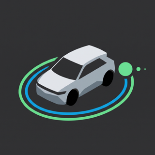
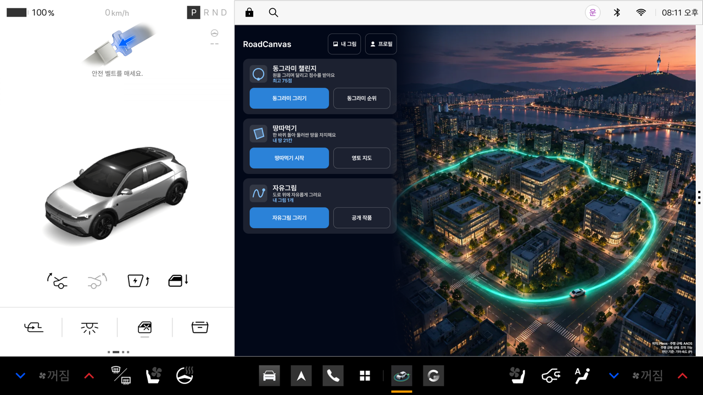
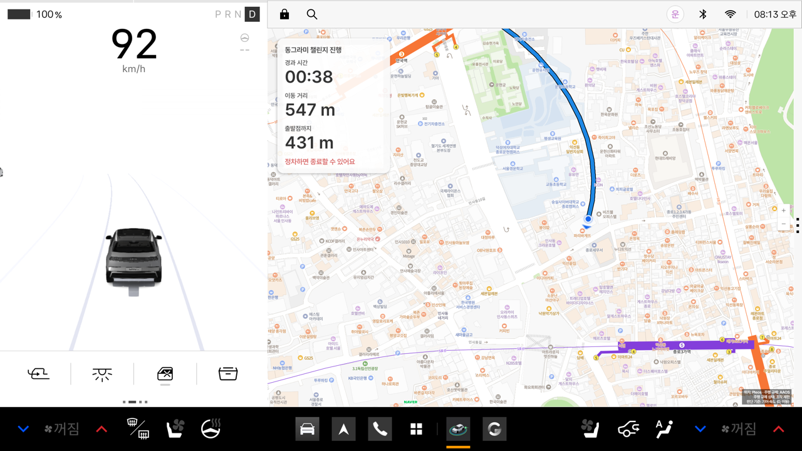

<div align="center">



# RoadCanvas (로드캔버스)

로드캔버스는 자동차로 달린 경로를 지도 위의 그림으로 만들어 영역을 차지하고, 점수를 겨루고, 다른 사람과 공유하는 게임입니다.

[](https://github.com/u-b-t/roadcanvas-hyundai-appdev-challenge/actions/workflows/android.yml)
[](https://github.com/u-b-t/roadcanvas-hyundai-appdev-challenge/actions/workflows/pleos-ui.yml)
[](https://codecov.io/gh/u-b-t/roadcanvas-hyundai-appdev-challenge)
<br />
[](https://github.com/u-b-t/roadcanvas-hyundai-appdev-challenge/releases/tag/v1.0.0)



<br />


</div>

## 실행 방법

```sh
adb install -r apk/RoadCanvas-1.0.0.apk
adb shell am start -n kr.roadcanvas.app/.MainActivity
```

처음 실행하면 필요한 권한을 앱이 요청합니다.

## 테스트 환경 및 필요한 설정

- 테스트 환경: macOS(Apple Silicon), Pleos Connect Emulator v2.1.0 AVD(Cold Boot, RAM 4GB)
- 인터넷 연결(네이버 지도, Firebase)
- 앱 권한 허용(위치, Pleos 위치, 알림, 차량 속도)
- Virtual Console: `adb forward tcp:8088 tcp:8088` 후 <http://127.0.0.1:8088/>을 열어 둡니다.
- 네이버 지도 Client ID(`gradle.properties`)와 Firebase 설정(`app/google-services.json`)을 공모전 심사용으로 저장소에 넣어 두어, 소스에서 빌드해도 별도 설정이 필요 없습니다. 두 키는 공모전 종료 후 재발급 예정입니다.

### Virtual Console 위치 연동

Virtual Console로 주행해도 에뮬레이터의 위치(GNSS)는 바뀌지 않아, 주행 경로를 그릴 수 없었습니다.
그래서 콘솔의 기어·속도·핸들 값으로 위치를 계산해 adb로 에뮬레이터에 보내는 스크립트를 만들었습니다.

```sh
python3 scripts/console-gps-bridge.py --lat 37.5665 --lon 126.9780
```

`--lat`, `--lon`은 출발 위치입니다.

## 에뮬레이터 버전과 화면 규격

- Pleos Connect Emulator v2.1.0 (Android 14, API 34)
- 2560 x 1440, 160dpi

## APK

- [`apk/RoadCanvas-1.0.0.apk`](apk/RoadCanvas-1.0.0.apk) (Git LFS)
- [GitHub Release v1.0.0](https://github.com/u-b-t/roadcanvas-hyundai-appdev-challenge/releases/tag/v1.0.0)
